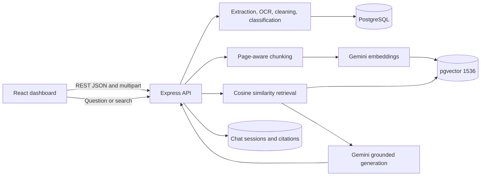

# DocuSense AI

DocuSense AI is an intelligent document processing and retrieval-augmented generation (RAG)
platform. It currently provides a React document workspace, a modular Express API, PDF/DOCX text
extraction, conditional OCR, deterministic document intelligence, LangChain-based text chunking,
Gemini embeddings, PostgreSQL vector storage, filtered semantic search, and citation-grounded Gemini
question answering built with Prisma ORM and pgvector. The responsive React dashboard provides
document management, document intelligence details, semantic search, grounded chat history, source
citations, and safe application settings in one light-theme workspace.

## Key features

- Validated PDF and DOCX upload with UUID storage names and safe deletion.
- Native text extraction, conditional page-aware OCR, cleaning, classification, and structured fields.
- Page-aware LangChain chunking and normalized Gemini embeddings.
- PostgreSQL `vector(1536)` storage with HNSW cosine-similarity search.
- Citation-grounded Gemini chat with persisted sessions and evidence refusal.
- Responsive React dashboard for documents, indexing, search, chat, and model metadata.
- Deterministic tests, synthetic RAG evaluation, rate limiting, health checks, and container configuration.

## Technology stack

| Layer     | Technology                                          |
| --------- | --------------------------------------------------- |
| Frontend  | React, TypeScript, Vite, Tailwind CSS               |
| Backend   | Node.js, Express, TypeScript                        |
| Data      | PostgreSQL, Prisma ORM, pgvector                    |
| AI        | Google Gemini generation and `gemini-embedding-001` |
| Documents | unpdf, Mammoth, Tesseract.js, `@napi-rs/canvas`     |
| Retrieval | LangChain text splitter, HNSW cosine index          |
| Delivery  | Docker, Docker Compose, Nginx                       |

## Architecture



The frontend never receives provider credentials, database credentials, stored filenames, file
paths, or embedding vectors.

## Application screenshots

Repository-ready screenshot slots and privacy guidance are in
[`docs/screenshots`](docs/screenshots/README.md). Screenshots are intentionally not fabricated; add
current captures using synthetic documents before publishing the repository.

## Prerequisites

- Node.js 24 or newer (required by the maintained PDF extraction package)
- npm 10 or newer
- PostgreSQL with pgvector available on the server (pgvector 0.5 or newer for HNSW indexing)
- Network access on the first OCR run, unless Tesseract English trained data is supplied locally

Classification and structured extraction are deterministic. A Gemini API key is required when
indexing, semantically searching, or answering questions from processed documents; uploads and
document intelligence continue to work without one.

## Installation

```bash
cd /Users/omgupta/Desktop/docusense.ai
npm install
cp backend/.env.example backend/.env
cp frontend/.env.example frontend/.env
```

Set `DATABASE_URL` in `backend/.env` to the PostgreSQL database that DocuSense AI should use.
The database role must be allowed to run `CREATE EXTENSION vector`, or pgvector must already be
enabled by an administrator.

Apply the database migration and generate Prisma Client:

```bash
npm run db:migrate
npm run db:generate
npm run db:verify
```

Never place provider or database secrets in the frontend environment. Vite exposes variables
prefixed with `VITE_` to browser code.

Set `GEMINI_API_KEY` only in `backend/.env`. The server uses the official `@google/genai` SDK with
`gemini-embedding-001` and requests 1,536 output dimensions. Do not add this secret to the frontend
environment or prefix it with `VITE_`.

Chunking defaults to approximately 1,000 characters with 150 characters of overlap. Override those
values with `CHUNK_SIZE` and `CHUNK_OVERLAP`; overlap must remain smaller than chunk size. Token
counts stored with chunks are lightweight estimates (`characters / 4`), not billing-token counts.

Semantic search defaults to five results with a cosine-similarity threshold of `0.25`. Configure
these safeguards with `SEARCH_DEFAULT_TOP_K`, `SEARCH_MAX_TOP_K`, and `SEARCH_MIN_SIMILARITY`.
RAG generation uses `GEMINI_GENERATION_MODEL` (default `gemini-3.8-flash`), a maximum of 1,024
output tokens, up to 12,000 context characters, and the latest eight conversation messages. These
limits are configurable through the backend environment.

`UPLOAD_DIR` defaults to `backend/uploads` during development. Production startup requires an
explicit path. Mount that path on persistent storage; ephemeral deployment filesystems will lose
uploaded files.

Tesseract.js downloads and caches its language data on first use. For an offline installation,
download compatible trained data yourself and set `OCR_LANG_PATH` to its directory or URL.
`OCR_LANGUAGE` defaults to `eng`, and `OCR_MAX_PAGES` defaults to `25` to prevent unexpectedly
expensive OCR jobs.

## Run both applications

```bash
npm run dev
```

- Frontend: <http://localhost:5173>
- Backend: <http://localhost:4000>
- Health check: <http://localhost:4000/api/health>
- Database health check: <http://localhost:4000/api/health/database>
- Safe application metadata: <http://localhost:4000/api/meta>

Open the frontend, drag a PDF or DOCX into the upload area, and wait for its processing status to
become `COMPLETED`. Files are limited to 10 MB. Select **View** to inspect cleaned text, OCR status,
classification, and structured fields.

Run one workspace independently if needed:

```bash
npm run dev --workspace frontend
npm run dev --workspace backend
```

## Validation commands

```bash
npm run typecheck
npm run lint
npm run format:check
npm run build
npm run db:validate
npm run db:status
npm run db:verify
npm run indexing:verify
npm run search:verify
npm run rag:verify
npm run test
npm run rag:evaluate
npm run verify
```

`npm test` uses deterministic Gemini mocks and synthetic records, so it makes no paid provider
calls and removes the database rows it creates. The RAG evaluation report is in
[`docs/RAG_EVALUATION.md`](docs/RAG_EVALUATION.md).

## Document upload API

All document endpoints are under `/api/documents` and require no authentication in this local
development phase.

| Method   | Endpoint                          | Purpose                                                         |
| -------- | --------------------------------- | --------------------------------------------------------------- |
| `POST`   | `/api/documents/upload`           | Upload one PDF or DOCX using multipart field `file`             |
| `GET`    | `/api/documents`                  | List document metadata without extracted text or storage paths  |
| `GET`    | `/api/documents/:id`              | Get document metadata and extracted text                        |
| `GET`    | `/api/documents/:id/intelligence` | Get cleaned text, category, OCR metadata, and structured fields |
| `POST`   | `/api/documents/:id/index`        | Chunk cleaned text, create embeddings, and store vectors        |
| `GET`    | `/api/documents/:id/chunks`       | List chunk metadata and text (never returns embedding values)   |
| `DELETE` | `/api/documents/:id`              | Delete the database record, associated chunks, and local file   |
| `POST`   | `/api/search`                     | Search indexed chunks by meaning with optional document filters |
| `POST`   | `/api/chat`                       | Ask a grounded question and create or continue a chat session   |
| `GET`    | `/api/chat/sessions`              | List saved chat sessions                                        |
| `GET`    | `/api/chat/sessions/:id`          | Load messages and persisted citations                           |
| `DELETE` | `/api/chat/sessions/:id`          | Delete a session and its messages                               |
| `GET`    | `/api/meta`                       | Return safe app, provider, and model metadata                   |

`GET /api/meta` is intentionally read-only and never returns API keys, database credentials,
filesystem paths, or other server secrets.

## Frontend dashboard

The light-theme application shell uses hash-based navigation without adding a routing dependency:

- **Dashboard** derives summary counts, recent uploads, processing activity, and type distribution
  from the real document list API. Its quick-upload and chat actions reuse existing flows.
- **Documents** provides filename search, type/status filters, responsive table/card layouts,
  pagination, upload, confirmed deletion, and detail navigation.
- **Document detail** loads the complete intelligence response, structured fields, original and
  cleaned text, OCR metadata, errors, indexing state, and the existing indexing action.
- **AI Chat** loads and continues saved sessions, renders assistant Markdown as React elements
  without raw HTML, and keeps source document/page excerpts expandable below answers.
- **Semantic Search** uses the existing pgvector search endpoint with an optional document filter.
- **Settings** reads only `/api/meta` and displays public product and model information.

Desktop navigation uses a fixed sidebar. Tablet and mobile layouts use a compact header with an
accessible slide-out menu. No authentication or user identity is fabricated.

Example upload:

```bash
curl -X POST http://localhost:4000/api/documents/upload \
  -F "file=@/absolute/path/to/document.pdf"
```

Successful processing returns `201 Created`. An unreadable document is retained with status
`FAILED` and returns `422 Unprocessable Entity`. Unsupported files return `415`, and files larger
than 10 MB return `413`.

Processing moves through `UPLOADED`, `PROCESSING`, and then `COMPLETED` or `FAILED`:

```text
Upload → native extraction → conditional OCR → cleaning → classification
       → structured extraction → database save
```

The server generates a UUID storage filename and validates the extension, MIME type, and binary
signature. API responses never expose the stored filename or filesystem path.

PDF text is extracted with `unpdf`; DOCX raw text is extracted with `mammoth`. PDFs with little or
no meaningful native text are rendered page-by-page to PNG with `unpdf` and `@napi-rs/canvas`, then
read with Tesseract.js. OCR output includes `[Page N]` markers. PDFs with readable native text skip
OCR.

The classifier uses weighted text patterns and supports `INVOICE`, `CONTRACT`,
`IDENTITY_DOCUMENT`, `RESUME`, and `GENERAL`. Invoice extraction returns nullable invoice number,
date, vendor, customer, subtotal, tax, total, and currency fields. Missing values remain `null`.

## Document indexing

Only documents whose processing status is `COMPLETED` can be indexed. Use the dashboard's **Index
document** action or call the endpoint directly:

```bash
curl -X POST http://localhost:4000/api/documents/DOCUMENT_ID/index
curl http://localhost:4000/api/documents/DOCUMENT_ID/chunks
```

The indexing workflow is:

```text
Cleaned text → paragraph/page-aware chunks → batched Gemini embeddings
             → dimension validation → DocumentChunk + pgvector transaction
```

`RecursiveCharacterTextSplitter` prefers paragraph and line boundaries, adds configurable overlap,
and preserves `[Page N]` markers as each chunk's nullable `pageNumber`. Chunks receive a sequential
zero-based `chunkIndex` and an estimated `tokenCount`.

Embedding requests use `gemini-embedding-001` with `RETRIEVAL_DOCUMENT`, a 1,536 output dimension,
bounded batches, timeouts, and retries for transient provider errors. Reduced-dimension Gemini
vectors are L2-normalized before storage. Every vector is validated before the database transaction.

Re-indexing is idempotent when the document is already indexed with the configured model and its
chunk count is consistent. A retry after a failed or stale index replaces old chunks safely. Chunk
creation, vector writes, and the final document status update share one database transaction, so a
provider or storage failure leaves no partial index. Indexing statuses are `NOT_INDEXED`, `INDEXING`,
`INDEXED`, and `FAILED`.

## Semantic search

The semantic search endpoint converts a natural-language query into a 1,536-dimension Gemini
embedding using the same configured model as document indexing. Query embeddings use
`RETRIEVAL_QUERY`; document chunks use `RETRIEVAL_DOCUMENT`. The server refuses mismatched vector
dimensions and searches only documents marked `INDEXED` whose `embeddingModel` matches the active
query model.

```text
Natural-language query → Gemini query embedding → pgvector cosine distance
                       → indexed/model/filter checks → ranked matching chunks
```

`POST /api/search` accepts a required query, an optional `topK`, one document ID, multiple document
IDs, or a document category:

```json
{
  "query": "What is the invoice total?",
  "topK": 5,
  "documentId": "DOCUMENT_ID"
}
```

For multiple documents or a category, use `documentIds` and `documentType`:

```json
{
  "query": "When can this agreement be terminated?",
  "documentIds": ["DOCUMENT_ID_1", "DOCUMENT_ID_2"],
  "documentType": "CONTRACT"
}
```

Example response:

```json
{
  "query": "What is the invoice total?",
  "topK": 5,
  "similarityThreshold": 0.25,
  "filters": {
    "documentIds": ["DOCUMENT_ID"],
    "documentType": null
  },
  "results": [
    {
      "chunkId": "CHUNK_ID",
      "content": "Total amount: USD 125.00",
      "documentId": "DOCUMENT_ID",
      "documentName": "synthetic-invoice.pdf",
      "documentType": "INVOICE",
      "chunkIndex": 2,
      "pageNumber": 1,
      "similarity": 0.91
    }
  ]
}
```

pgvector's `<=>` operator returns cosine distance. DocuSense reports
`similarity = 1 - cosine_distance`, so a larger score ranks as more similar. The query uses
parameterized raw SQL, orders directly by cosine distance so the existing HNSW
`vector_cosine_ops` index is compatible, applies the configured threshold, and never returns vector
values. Filters are also bound parameters rather than interpolated SQL.

## RAG question answering

RAG means retrieval-augmented generation. DocuSense first retrieves relevant indexed chunks, then
asks Gemini to answer using only that bounded document context:

```text
Question → RETRIEVAL_QUERY embedding → pgvector top chunks → bounded context
         → Gemini structured answer → validated citations → transactional chat save
```

The generation system instruction treats uploaded text and conversation history as untrusted data,
rejects instructions found inside documents, prohibits unsupported facts, and requires an explicit
insufficient-evidence response when context cannot answer the question. Conversation history is
limited and used only for continuity; the current question always performs fresh retrieval.

The chat document chooser lets a user upload a PDF or DOCX without leaving the conversation,
automatically process and index it, and restrict retrieval to one or more selected documents. The
selected context is saved with the conversation. An empty selection searches all successfully
indexed documents. Expandable citations link back to the source document detail view.

Gemini returns structured JSON with `answer`, `sourceReferences`, and `sufficientEvidence`.
`sourceReferences` are numeric positions in the server-created context. The server discards invalid
positions and rebuilds every citation from the original PostgreSQL search result, so the model cannot
invent trusted document names, chunk IDs, or page numbers. If retrieval returns no chunks, Gemini is
not called and DocuSense returns a deterministic insufficient-evidence answer.

Create or continue a conversation:

```json
POST /api/chat
{
  "question": "What is the total invoice amount?",
  "sessionId": null,
  "topK": 5,
  "documentIds": ["OPTIONAL_DOCUMENT_ID"]
}
```

Example response:

```json
{
  "sessionId": "SESSION_ID",
  "answer": "The total invoice amount is USD 125.00.",
  "sufficientEvidence": true,
  "citations": [
    {
      "documentId": "DOCUMENT_ID",
      "documentName": "synthetic-invoice.pdf",
      "chunkId": "CHUNK_ID",
      "chunkIndex": 2,
      "pageNumber": 1,
      "sourceText": "Total amount: USD 125.00"
    }
  ]
}
```

The React **Ask documents** view supports new and existing sessions, user and assistant messages,
loading and error states, and expandable source excerpts below assistant answers.

## Important files

- `package.json`: npm workspaces and commands shared by the monorepo.
- `eslint.config.mjs`: TypeScript, React Hooks, and Node lint rules.
- `.prettierrc.json`: consistent formatting for both applications.
- `frontend/vite.config.ts`: Vite, React, and Tailwind CSS v4 integration.
- `frontend/src/index.css`: loads Tailwind through its v4 CSS import.
- `frontend/src/services/documents.api.ts`: isolated browser API client, including upload progress.
- `frontend/src/services/search.api.ts`: isolated semantic-search API client.
- `frontend/src/services/chat.api.ts`: isolated chat and session API client.
- `frontend/src/services/api-client.ts`: shared error handling and JSON request behavior.
- `frontend/src/services/meta.api.ts`: safe application metadata client.
- `frontend/src/layouts/AppShell.tsx`: responsive sidebar and mobile navigation shell.
- `frontend/src/pages`: dashboard, document library, detail, and settings page components.
- `frontend/src/hooks`: document workflow state and hash-based navigation.
- `frontend/src/components/ui`: reusable buttons, cards, badges, dialogs, loading, feedback, icons,
  page headers, and safe Markdown presentation.
- `frontend/src/components`: upload dropzone and document-list presentation components.
- `frontend/src/components/DocumentDetailPanel.tsx`: intelligence detail view and loading/error UI.
- `frontend/src/components/SemanticSearchPanel.tsx`: search form, document filter, states, and ranked
  result cards.
- `frontend/src/components/ChatPanel.tsx`: chat history, composer, session list, and citation viewer.
- `backend/src/config/env.ts`: loads and validates server-side configuration.
- `backend/prisma/schema.prisma`: Prisma models, relations, enums, and the declared unsupported
  pgvector field.
- `backend/prisma/migrations`: versioned SQL, including pgvector activation and the HNSW index.
- `backend/src/database/prisma.ts`: the shared Prisma client and connection lifecycle helpers.
- `backend/src/database/vector.ts`: parameterized vector writes and cosine-similarity queries.
- `backend/src/database/verify-database.ts`: reusable live database integration verification.
- `backend/src/database/verify-indexing.ts`: real-database indexing checks with a deterministic mock
  embedding provider (no API usage or cost).
- `backend/src/database/verify-search.ts`: real pgvector semantic-search checks with deterministic
  query embeddings and synthetic data.
- `backend/src/database/verify-rag.ts`: full retrieval, grounded generation, citation, history, and
  persistence verification with mock Gemini output.
- `backend/src/middleware/document-upload.ts`: Multer storage, size limit, and file-type filtering.
- `backend/src/services/document-extraction.service.ts`: PDF and DOCX text extraction.
- `backend/src/services/ocr.service.ts`: page rendering and sequential Tesseract OCR.
- `backend/src/services/text-cleaning.service.ts`: reusable text normalization and OCR threshold.
- `backend/src/services/text-chunking.service.ts`: page-aware LangChain chunking and metadata.
- `backend/src/services/gemini-embedding.service.ts`: Gemini batching, retry, validation, and
  normalization.
- `backend/src/services/document-indexing.service.ts`: idempotent transactional indexing workflow.
- `backend/src/services/semantic-search.service.ts`: validation, query embedding, filters, and search
  error handling.
- `backend/src/services/gemini-generation.service.ts`: grounded structured Gemini generation,
  retries, timeout, and output validation.
- `backend/src/services/chat.service.ts`: RAG orchestration, citation validation, and chat persistence.
- `backend/src/services/document-classification.service.ts`: weighted deterministic classification.
- `backend/src/services/structured-extraction.service.ts`: category-specific nullable field extraction.
- `backend/src/services/document-processing.service.ts`: the complete intelligence workflow.
- `backend/src/services/document.service.ts`: document persistence, status updates, and safe deletion.
- `backend/src/app.ts`: creates and configures the Express application.
- `backend/src/server.ts`: starts the HTTP server and handles graceful shutdown.
- `backend/src/routes`: maps API paths to controllers.
- `backend/src/controllers/meta.controller.ts`: public non-secret application and model metadata.
- `backend/src/controllers`: translates HTTP requests and responses.
- `backend/src/services`: contains application and domain logic.
- `backend/src/middleware`: contains shared request/error middleware.
- `backend/src/utils`: contains reusable backend utilities.
- `backend/src/types`: contains shared backend TypeScript types.

## Health-check contract

`GET /api/health` requires no authentication and has no side effects.

Example `200 OK` response:

```json
{
  "status": "ok",
  "service": "docusense-ai-api",
  "timestamp": "2026-11-15T00:00:00.000Z"
}
```

`GET /api/health/database` checks PostgreSQL with `SELECT 1`. It returns `200` when connected:

```json
{
  "status": "ok",
  "database": "connected",
  "timestamp": "2026-11-15T00:00:00.000Z"
}
```

It returns `503` with `database: "disconnected"` if a connection that was previously established
becomes unavailable.

## Database schema

- `Document` has many `DocumentChunk` records with cascading deletion.
- `ChatSession` has many `ChatMessage` records with cascading deletion.
- Assistant messages store validated source citations in JSON and an evidence flag; embeddings are
  never stored in JSON.
- Every chunk can hold one nullable `vector(1536)` embedding.
- An HNSW index using `vector_cosine_ops` supports cosine-similarity retrieval.
- Prisma 7 does not natively expose the pgvector type, so the schema declares
  `Unsupported("vector(1536)")` and vector operations use parameterized raw SQL. The field remains
  represented in the Prisma schema, preventing later migrations from treating it as an unknown
  column.

## Environment variables

Backend variables are documented in `backend/.env.example`. `DATABASE_URL` is required when the API
starts; upload, OCR, and chunking settings are optional. `GEMINI_API_KEY` is required for live
indexing and semantic search. `GEMINI_EMBEDDING_MODEL` defaults to `gemini-embedding-001`, and
`GEMINI_EMBEDDING_DIMENSIONS` is fixed at `1536` to match the database column. Frontend variables
are documented in `frontend/.env.example`; only non-secret browser configuration belongs there.

`GEMINI_GENERATION_MODEL` selects the separate Gemini text-generation model and defaults to
`gemini-3.8-flash` when blank. `GEMINI_GENERATION_MAX_TOKENS`, `RAG_MAX_CONTEXT_CHARACTERS`, and
`RAG_HISTORY_MESSAGE_LIMIT` bound model output, retrieved context, and conversation history. The same
backend-only `GEMINI_API_KEY` authenticates embeddings and generation.

Run `npm run indexing:verify` to exercise long multipage chunking, 1,536-dimension vector storage,
idempotent re-indexing, provider failure cleanup, empty-document rejection, and cascading deletion
against the configured PostgreSQL database. It uses synthetic data and a deterministic mock provider,
then removes all records it created.

Run `npm run search:verify` to test exact-word and synonym ranking, cross-document search, single and
multiple document filters, document-type filtering, empty results, invalid requests, provider and
database failures, indexed/model isolation, and descending similarity order. It uses a deterministic
mock Gemini provider with the real PostgreSQL/pgvector search query and cleans up its synthetic rows.

Run `npm run rag:verify` to test exact and paraphrased invoice questions, amount and date answers,
no-context behavior, citation ID/page validation, invalid citation removal, empty input, invalid
sessions, Gemini failure handling, bounded history, persisted messages/citations, and cascading chat
deletion. It uses mock Gemini generation with the real database retrieval path and removes its
synthetic records.

To test the live provider locally, use synthetic documents, index them from the **Documents** view,
then open **Semantic search**:

```bash
curl -X POST http://localhost:4000/api/search \
  -H "Content-Type: application/json" \
  -d '{"query":"What is the invoice total?","topK":5}'
```

Verify relevance by searching first for exact text from a known chunk, then a paraphrase with the
same meaning. The expected document should remain near the top, scores should be in descending
order, an optional document filter should exclude all other documents, and unindexed documents
should never appear.

To test live RAG, index a synthetic document, open **Ask documents**, ask a question answered by the
file, inspect the citation excerpt, then ask a paraphrase and an unrelated question. The first two
should cite real retrieved chunks; the unrelated question should report insufficient evidence rather
than invent an answer.

## Local intelligence testing

Use only synthetic or non-confidential documents. A text-based PDF should finish without OCR. An
image-only PDF should return `ocrUsed: true`. An invoice with explicit labels such as `Invoice
Number:`, `Vendor:`, `Subtotal:`, `Tax:`, and `Total:` demonstrates deterministic extraction.

```bash
curl -X POST http://localhost:4000/api/documents/upload \
  -F "file=@/absolute/path/to/synthetic-invoice.pdf"

curl http://localhost:4000/api/documents/DOCUMENT_ID/intelligence
```

OCR is CPU-intensive and intentionally runs sequentially per document. Production deployments
should also add authentication, persistent object storage, and a background job queue before
accepting untrusted public uploads.

## Security and access model

The API has request validation, explicit CORS origins, Helmet headers, general/upload/AI rate
limits, guarded file deletion, parameterized vector SQL, bounded model requests, and an explicit
prompt-injection boundary. See [`docs/SECURITY.md`](docs/SECURITY.md) for the complete review.

Authentication, user accounts, ownership checks, and tenant isolation are not implemented. Anyone
who can reach the API can access every document and chat session. Do not expose this version as a
public multi-user service.

## Deployment

Dockerfiles are provided for the Express API and Nginx-served frontend. `docker-compose.yml`
provides PostgreSQL with pgvector, a controlled migration job, persistent database/upload volumes,
and health checks.

```bash
export GEMINI_API_KEY="your-backend-only-key"
docker compose up --build
```

This prepares a local container deployment only. No external hosting account was created and no
production deployment is claimed. Follow [`docs/DEPLOYMENT.md`](docs/DEPLOYMENT.md) for production
environment variables, migration order, backups, persistent storage, and Gemini cost monitoring.

## Known limitations

- No authentication, authorization, document ownership, or multi-tenancy.
- Local files require one persistent backend volume and do not support horizontal scaling.
- Upload processing and OCR are synchronous; large workloads need a background queue.
- The default rate-limit store is process-local; multiple replicas need a shared store.
- Deterministic extraction and the small synthetic evaluation need representative domain testing.
- Live Gemini latency, availability, and cost vary by model and account tier.

## Project reports

- [Final audit](docs/AUDIT.md)
- [Security model](docs/SECURITY.md)
- [RAG evaluation](docs/RAG_EVALUATION.md)
- [Deployment preparation](docs/DEPLOYMENT.md)
- [Portfolio summary and interview questions](docs/PORTFOLIO.md)
